# The Great Journey

**CurseForge summary (one line):** A Warrior Cats RPG modpack: walk the Clan territories from the books, from Fourtrees and the old forest to the lake, as a kittypet, a Clan apprentice or a loner.

Wake as a cat in the world of the Clans. Every world of The Great Journey is built around the territories from Erin Hunter's Warriors books: the lake territories where you start, the old forest with Fourtrees about ten kilometres away, and the long road of the Great Journey between them. Four living Clans keep their camps, patrol their borders, raise their kits and argue at the edge of their land. Learn the warrior code in a StarClan dream, pick how your story begins, and find your place among them.

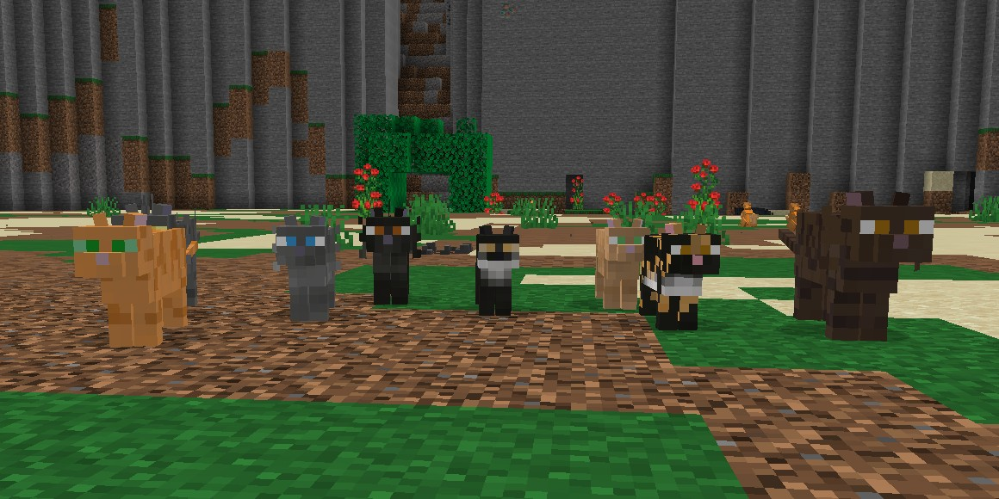

## Requirements

| | |
|---|---|
| **Minecraft** | 1.21.1 |
| **Loader** | NeoForge **21.1.249** |
| **Java** | 21 |
| **RAM** | **6 GB** allocated recommended |
| **Players** | Singleplayer or multiplayer |

## Start your story

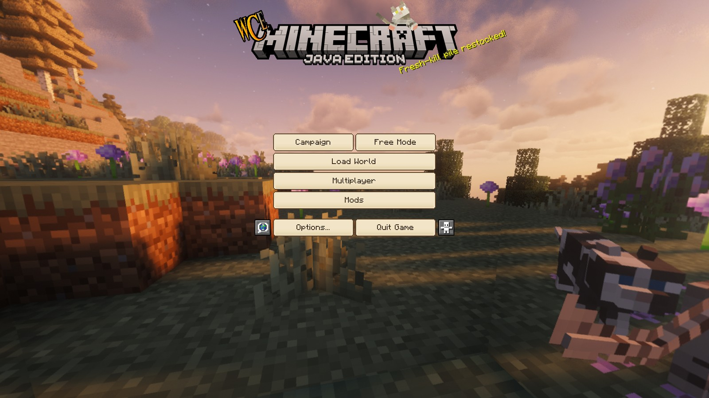

The title screen offers **Campaign**, **Free Mode** and **Load World**. Both modes begin with a short StarClan dream: Bluestar, Lionheart, Spottedleaf and Yellowfang teach you what every Clan cat must know (you can skip it). Then choose how your story begins:

1. **A kittypet at the forest edge**, curious about the wild cats beyond the fence.
2. **Join a Clan now**: ThunderClan, WindClan, RiverClan or ShadowClan. The leader names you an apprentice in front of the whole Clan.
3. **A loner by the lake**, belonging to no one, until a patrol finds you and asks you to join.

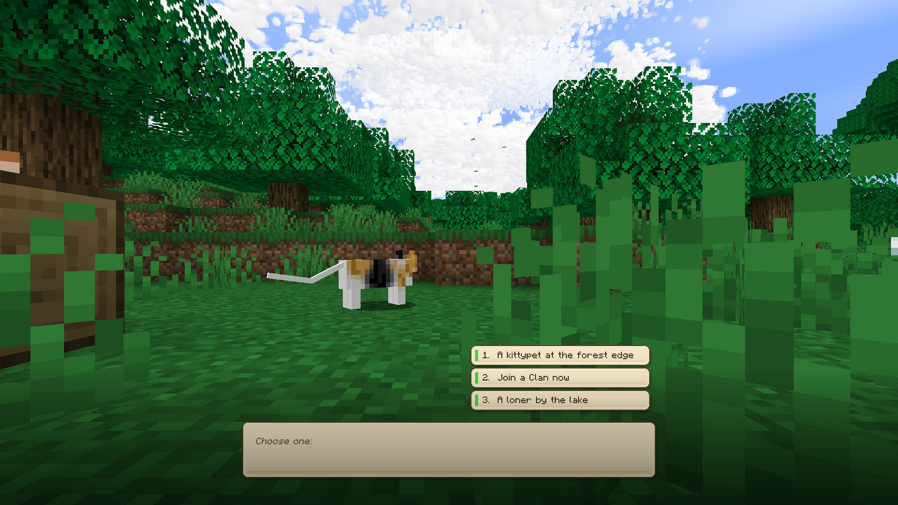

**Free Mode** puts you at the lake, where the four Clans already live. **Campaign** tells the story in the books' order, in four acts: it opens with the Gathering at Fourtrees under the full moon, with the four leaders on the Great Rock. Then the old forest falls to the Twolegs' monsters, StarClan sends a sign, a cat hears the badger Midnight, and the Clans set out together on the Great Journey to the lake. The acts belong to the world, so friends who join late begin at the chapter that fits.

## The book worlds

No two worlds match: every shoreline, river bend, border and landmark is drawn from the seed, but the books' arrangement always holds.

- **The lake territories at spawn.** ShadowClan's pines to the north-west, ThunderClan's woods to the north-east, RiverClan's marsh and streams to the south-west and WindClan's moor to the south-east. The Gathering island with its fallen-tree bridge, the horseplace, the half-bridges, the Sky Oak, the abandoned Twoleg nest, and the Moonpool high in the hills at the head of the border stream.
- **The old forest, about ten kilometres to the south-east.** Fourtrees with its four great oaks and the Great Rock, Sunningrocks and the stepping stones, the river plunging thirty blocks into a sheer rock gorge, Snakerocks, Tallpines and the Twolegplace, Carrionplace, Barley's farm, and far to the west Highstones, where Mothermouth leads down to the Moonstone.
- **The Great Journey between them.** The great highway, the Twoleg farms, the mountain pass where eagles hunt, the cave of the Tribe of Rushing Water behind its roaring waterfall, Midnight's sett by the sea where the sun drowns, and the ridge where the Clans first saw the lake. The Tribe, Midnight and Purdy live where the books put them.
- **The tunnels** under the ThunderClan and WindClan border: a cavern with a dark stream and glowing rocks to light the way, and a sharp-tongued medicine cat who keeps it.
- **No giant mountains.** The drama comes from ravines, gorges and waterfalls.

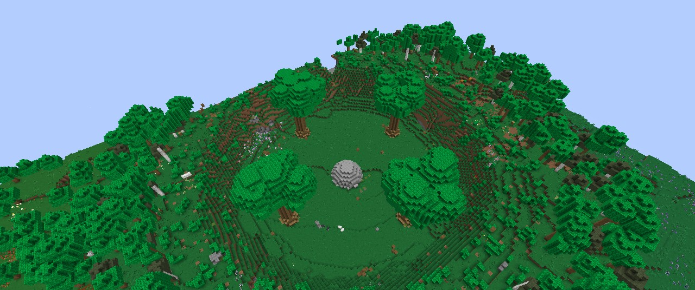

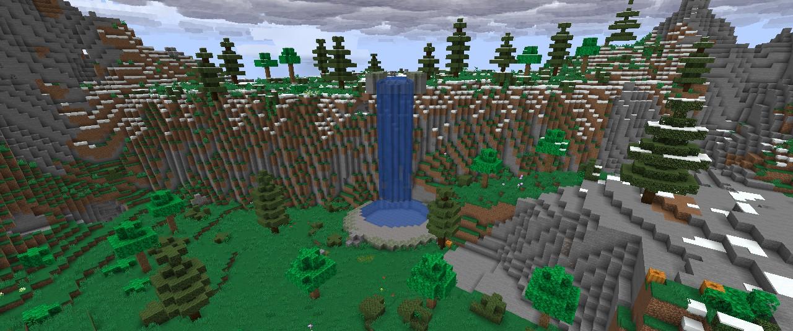

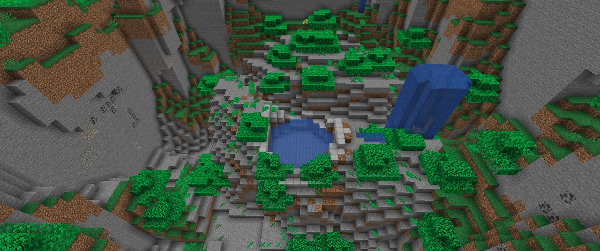

## Camps from the books

Every camp has one way in, a natural barrier all round, and dens where the books put them, with the Clan's cats settled into their own nests. Predators and monsters are kept out of camp.

- **The stone hollow:** ThunderClan's lake camp in an old quarry, with sheer walls, a thorn tunnel, Highledge and the leader's cave, the medicine cleft with its pool, the elders under honeysuckle and a bramble nursery.
- **The ravine camp:** ThunderClan's old-forest home, a bramble-and-gorse ring at the foot of a rocky ravine, with the gorse tunnel, Highrock and the fern tunnel to the medicine den.
- **WindClan:** a hollow on the open moor ringed by gorse, with Tallrock and dens dug into its sides.
- **RiverClan:** reeds, brambles and willows where the streams meet; in the old forest, an island in the river with a ford of stones.
- **ShadowClan:** a dense bramble wall with one tunnel under dark pines, and the leader's den beneath a great rock.

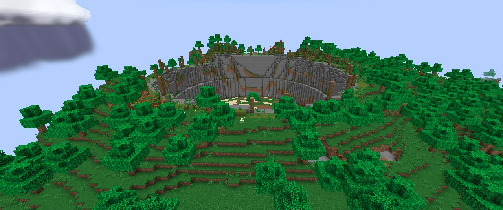

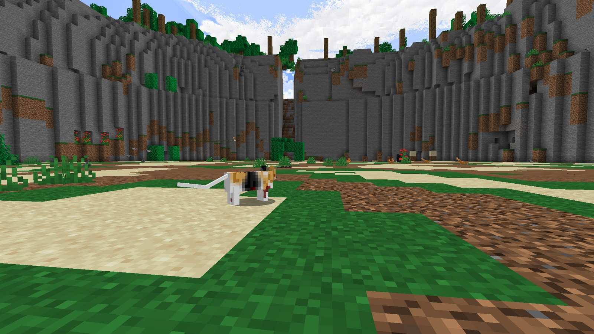

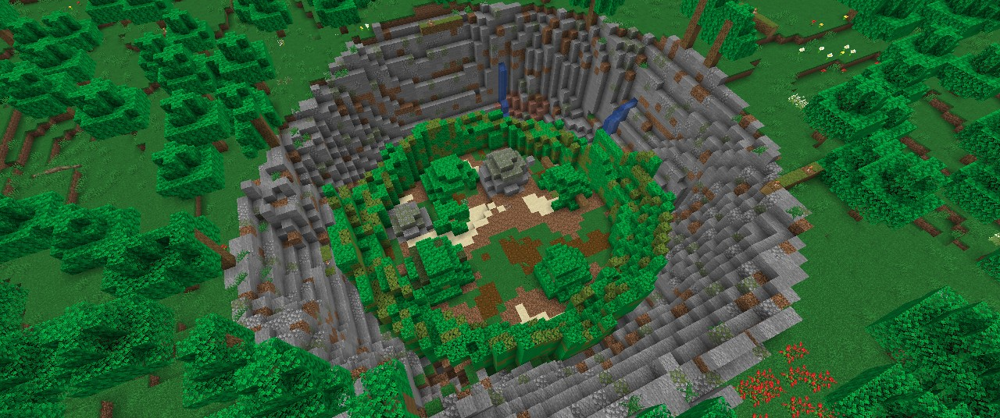

## Clan life

- **Talk to any Clan cat.** A dialogue window with the speaker's portrait, text that writes itself out and choices to answer with.
- **Duties.** Ask a Clanmate if they need help: the medicine cat sends you for herbs, the deputy for hunting and border patrols, the elders want fresh moss and the queens food for the nursery.
- **The apprentice path.** Your mentor teaches you the territory, hunting, herbs, a border patrol and the places every apprentice knows, then tests you. Pass, and the leader holds your warrior ceremony and you choose your warrior name.
- **The journal** keeps your tasks, your duties, your Clanmates, the places you have found and the cats who walk with StarClan.
- **Clan events:** badgers, foxes and eagles, border raids, injuries and seasonal sickness, new kits, warrior ceremonies, hunting patrols and a lost kit. Cats die as they do in the books, without gore: a vigil, a place in StarClan's memory, and a leader's nine lives.
- **Weather from the books:** the lake's edge freezing in leaf-bare, RiverClan's marsh flooding after rain, the shallows drying to mud in a drought, lightning setting a tree alight, morning mist that spoils the hunting. The seasons are newleaf, greenleaf, leaf-fall and leaf-bare.

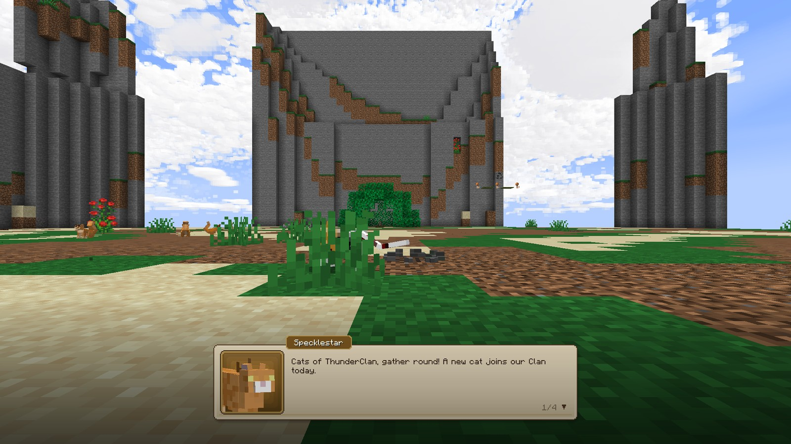

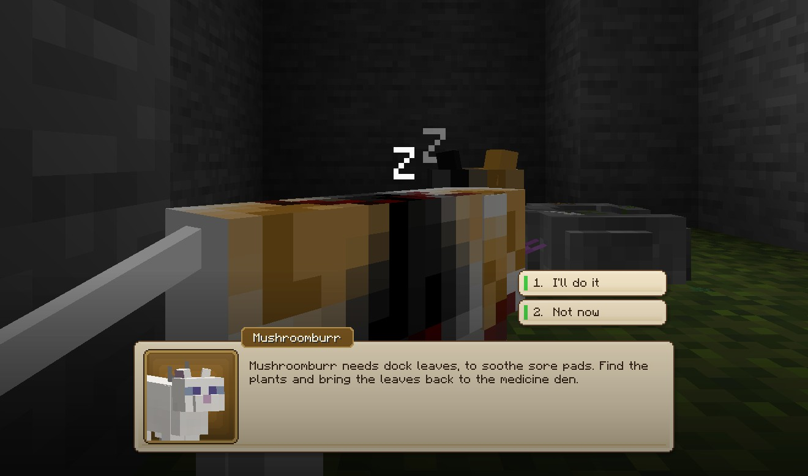

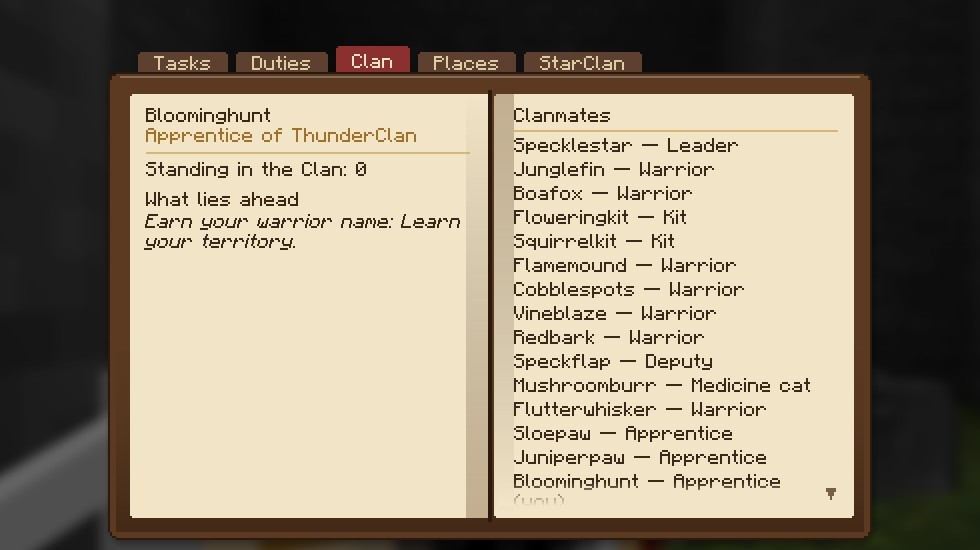

## Monsters on the Thunderpaths

Twoleg monsters, cars and long trucks, growl closer, roar past and are gone. The great highway is busy, the forest Thunderpaths only now and then, and a monster hurts whatever it hits, so a wise cat waits, listens, and crosses only when all is quiet. Clan cats scatter off the road too. Server owners can tune or switch off the traffic.

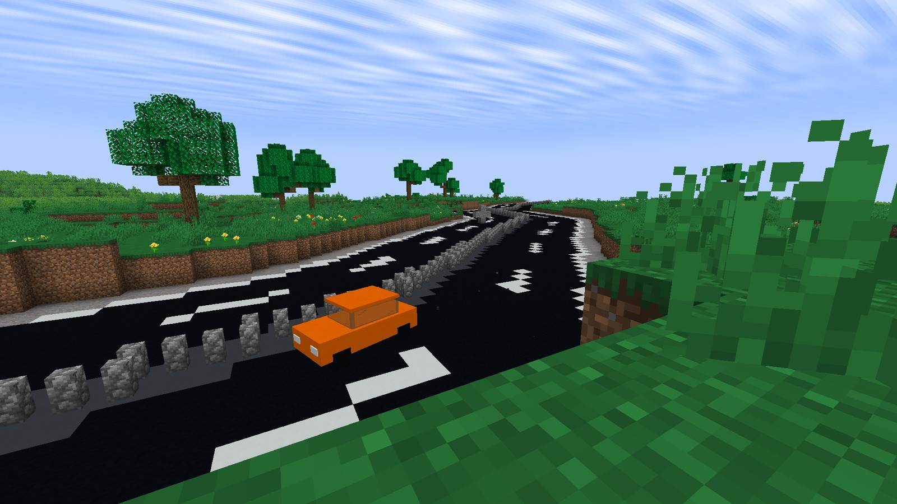

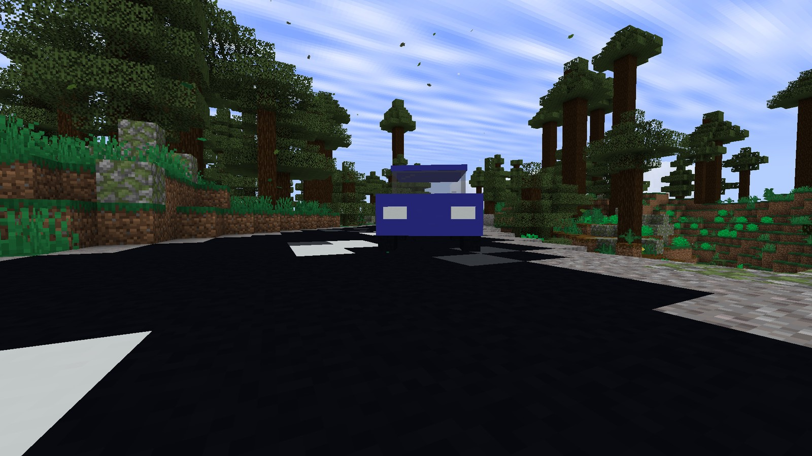

## A guided tour

New to the books, or just want to see it all? `/greatjourney tour` flies you over the world in the books' order, twenty-two stops from Fourtrees, along the Great Journey, to the lake and the Moonpool, each with a caption, then puts you back where you were.

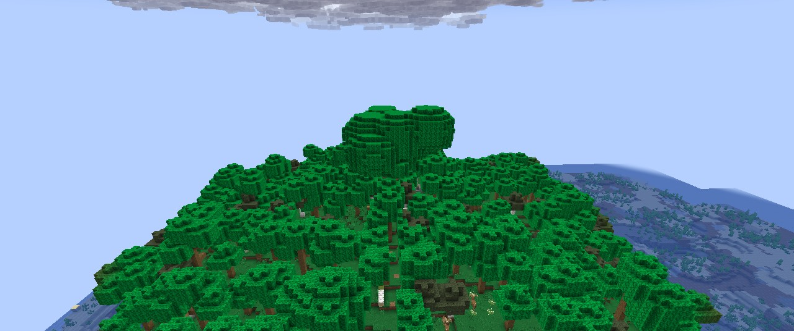

## Play together

The Great Journey is multiplayer playable. Bring friends to the same Clan or to rival ones; each player walks their own apprentice path, and the Campaign's acts are shared by the whole world.

## Coming

- **Gatherings at every full moon** in Free Mode, on the island, with each leader's news (the Campaign already has its first Gathering at the lake).
- **Moonpool dreams:** StarClan visits, including the cats who have fallen in your world.
- **Border skirmishes** between the Clans.

## Mods

About 80 mods, chosen to make a cat's world: **Warrior Cats Events** is the heart of the cat gameplay (your cat, Clans, herbs, prey, accessories and the Clan cats themselves), with **Woodwalkers** turning you into your cat, GeckoLib for the models, Alex's Mobs and Naturalist for prey and predators, Serene Seasons, Project Atmosphere, Weather, Storms & Tornadoes and Simple Clouds for the sky, Dynamic Waters, Biomes O' Plenty and Oh The Biomes We've Gone for the land, Shoulder Surfing Reloaded, Fresh Animations, Sound Physics Remastered, Immersive Minimaps, JEI and Jade, and Sodium with a set of performance mods. The pack's own **Great Journey Core** (Clanlands and Clanwild) builds the book worlds and the Clan life.

## Credits

- **Warriors** is created by **Erin Hunter**. The Great Journey is a free, unofficial fan pack, inspired by the books; it is not affiliated with or endorsed by the authors or publishers of Warriors.
- **Warrior Cats Events** by Klyonstar is the heart of the cat gameplay.
- **The Great Journey Core** (Clanlands and Clanwild) and the pack by AhmiDarrow, made by a family of Warriors fans.
- Every other mod is downloaded from CurseForge by the launcher and stays under its own author's license; see the pack's mod list for all of them.
